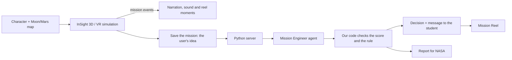

# Mission Echoes 🚀
### Team Interstellar · NASA Space Apps Challenge 2026 · Ramallah

**Challenge:** *Abandoned but not Forgotten: Storytelling about NASA's Discarded Equipment on the Moon and Mars*

Mission Echoes is a web-based interactive VR simulation that brings NASA hardware left on the Moon and Mars back to life, then turns the visitor into the engineer who helps the next mission succeed. It runs in any browser on a laptop, a phone or a VR headset (WebXR), with nothing to install.

> 🎬 **Demo video (2 min):** [demo/Mission_Echoes_demo.mp4](demo/Mission_Echoes_demo.mp4)

---

## The problem

Most students only *read* about space missions. They memorise a fact and forget it a few days later. Meanwhile, NASA hardware on the Moon and Mars carries real stories of success and failure that never reach a classroom. Some of these failures are still not fully solved.

## Our solution

We turn each abandoned machine into a story the student **lives**, then **finishes** with their own idea.

| Step | What the user does |
|---|---|
| 1. Pick a character | The Dreamer, The Gamer or The Physics Student. Each one has its own colours and ending. |
| 2. Explore the Moon and Mars | Zoom into an interactive map of real NASA landing sites: Apollo 11, the Apollo 15 and 17 Lunar Roving Vehicles and Surveyor 3 on the Moon; Spirit, Opportunity, Ingenuity and InSight on Mars. |
| 3. Live the story in 3D or VR | Walk around NASA's real InSight lander on Martian terrain and run its experiments: the heat probe digging into the ground and the seismometer listening for marsquakes. Narration and sound effects follow every event. |
| 4. Save the mission | Learn what really went wrong, then answer one question: *How would you save the next mission?* |
| 5. Get a decision | The **Mission Engineer** AI agent evaluates the idea and replies with a clear, encouraging explanation. |
| 6. Share a Mission Reel | A vertical video made from moments recorded inside the 3D scene, the user's photo in an astronaut helmet, a mission patch if the idea was accepted, and ready-made hashtags. |

---

## The Mission Engineer agent

The agent acts like a NASA engineer reviewing ideas. For each failure it receives a **problem card**: verified facts from NASA sources and the solutions NASA already tried.

### Five criteria, each scored from 1 to 5

| Criterion | Question | Weight |
|---|---|---|
| Root cause | Does the idea address the real cause of the failure? | ×5 |
| Principle | Is it physically sound on Mars: thin air, dust, cold, low power, no humans to repair it? | ×5 |
| Novelty | Is it different from what NASA already tried? | ×4 |
| Feasibility | Could engineers build it within mass and power limits? | ×3 |
| Simplicity | Does it avoid adding new parts and new ways to fail? | ×3 |

```
total = 5 × RootCause + 5 × Principle + 4 × Novelty + 3 × Feasibility + 3 × Simplicity   (max 100)

send to NASA  only if  RootCause ≥ 3  and  Principle ≥ 3  and  Novelty ≥ 4  and  total ≥ 75
```

### Why the decision can be trusted

- **Our code has the final word.** It recomputes the score and applies the rule itself, so the decision never depends on the language model's arithmetic.
- **Consistent.** The same idea always gets the same result.
- **Grounded.** The agent may use only the facts in the problem card plus well-established physics.
- **Fair to every student.** It understands Modern Standard Arabic, Arabic dialects (Palestinian, Egyptian, Gulf), Arabizi and English. Spelling or dialect never lowers a score.
- **Protected.** Text the user writes is treated only as an idea to evaluate, never as instructions. Empty, unrelated or inappropriate input is rejected.
- **A human in the loop.** For every accepted idea, the agent writes a short English report for NASA: the problem, the idea, why it could help and its main risk. A team member reviews the report before it is sent.

### Open problems covered

| Machine | Failure |
|---|---|
| InSight | Its self-hammering heat probe ("the mole") could not dig into the Martian soil. |
| Opportunity, InSight | Dust stopped sunlight from reaching the solar panels, so the spacecraft ran out of power. |
| Spirit | The rover got stuck in hidden soft sand and could not drive out. |
| Ingenuity | The helicopter lost track of its position over smooth sand, landed hard and damaged its rotor blades. |

---

## How it works



- The 3D scene tells the website when each mission starts and ends (`postMessage`). The website then plays the narration, records reel moments and opens the challenge.
- The Mission Reel is built entirely on the user's device. Nothing is uploaded.

---

## Technology

| Area | Tools |
|---|---|
| Languages | JavaScript, HTML, CSS, Python |
| 3D and VR | three.js (WebGL), WebXR, GLTF models with Draco compression, custom shaders (Martian sky, marsquake waves), procedural terrain from noise functions, raycasting for desktop and VR controllers, Vite (development) |
| NASA data | NASA 3D Resources (official InSight model), NASA mission pages |
| AI | Large language model through its API (Google Gemini by default; Anthropic Claude and OpenAI also supported), prompt engineering with a fixed scoring rubric, JSON output |
| Backend | Lightweight Python server built only on the standard library |
| Browser APIs | Web Audio API (narration and sound), Canvas + MediaRecorder (Mission Reel), postMessage (3D scene ↔ website) |
| Media | FFmpeg (demo video); Python with NumPy and SciPy to create every sound effect in code, with no music |
| Collaboration | Git and GitHub |

---

## Run it locally

Requirements: Python 3.9 or newer and a recent browser (Chrome or Edge). A VR headset is optional.

```bash
python server.py
```

Then open **http://localhost:8000/demo.html**.

To try the 3D scene on its own, open http://localhost:8000/insight/.

---

## Project structure

```
mission-engineer/
├── server.py              Web server and API
├── agent/
│   ├── agent.py           Calls the model, checks its answer, recomputes the score and the decision
│   ├── prompt.py          The agent's instructions and scoring rubric
│   └── problems.json      The open problems: NASA facts and what NASA already tried
├── static/
│   ├── demo.html          The full website: characters → map → 3D story → challenge → reel
│   ├── index.html         The "Save the mission" challenge page
│   ├── reel.js            Mission Reel video builder
│   ├── insight/           InSight 3D / VR simulation (three.js + WebXR)
│   ├── characters/        Character images
│   └── sounds/            Narration, sound effects and Mars wind
├── demo/                  Demo video
└── test_cases.py          Three sample ideas: weak, already tried by NASA, and new
```

---

## Privacy and safety

- No personal information is requested. If a user writes a name or contact details, they are removed from the output.
- The user's photo for the reel never leaves their device.
- The agent ignores any instructions hidden inside a user's idea.

---

## Future work

- Test the experience in schools with VR headsets.
- Bring it to schools and universities.
- An AI model that learns each user's style and adapts the experience to them.
- Add 3D stories for more abandoned machines on the Moon and Mars.

---

## Team Interstellar

| Member | Role |
|---|---|
| Shatha Yasin | Technical Development & VR Environment Design |
| Sarah Jack | Research & Scientific Fact-Checking |
| Toqa Masoud | Storytelling & Creative Direction |
| Rama Darwazeh | Presentation & Communication |
| Shahd Loai | AI-Assisted Feedback & User Experience Evaluation |

---

## Sources

**NASA**
- InSight mission: https://science.nasa.gov/mission/insight/
- Ingenuity Mars Helicopter: https://science.nasa.gov/mission/mars-2020-perseverance/ingenuity-mars-helicopter/
- NEAR Shoemaker mission: https://science.nasa.gov/mission/near-shoemaker/
- Pioneer 10 mission: https://science.nasa.gov/mission/pioneer-10/
- Kepler mission: https://science.nasa.gov/mission/kepler/
- NASA 3D Resources: https://science.nasa.gov/3d-resources/

**Video references**
- https://youtu.be/1Mqsd0ru_pc
- https://youtu.be/4RFUkJ31x5s

**Narration voice**
- ElevenLabs, voice "Spuds Oxley": https://elevenlabs.io/voices/NOpBlnGInO9m6vDvFkFC

Built for the NASA Space Apps Challenge 2026. three.js is used under the MIT License.
